# Diagrama entidad-relación — GeekPoint

Modelo vigente desde la migración `2026_10_19_000001_normalizar_catalogo_inventario.sql`,
con los catálogos de roles y métodos de pago de `2026_11_11_000001_roles_metodos_pago.sql`.
Fuente de verdad: [`database/schema.sql`](../database/schema.sql).

Para el diagrama del reporte: Diseñador de phpMyAdmin + [`database/acomodar_disenador.js`](../database/acomodar_disenador.js),
que ya acomoda también `roles`, `payment_methods`, `sale_payments` y `cash_cuts`.

```mermaid
erDiagram
    ROLES ||--o{ USERS : "define el rol de"
    BRANCHES ||--o{ USERS : "asigna (gerente/cajero)"
    BRANCHES ||--o{ REGISTERS : tiene
    BRANCHES ||--o{ INVENTORY : "guarda stock de"
    BRANCHES ||--o{ SALES : registra
    BRANCHES ||--o{ CASH_CUTS : "corta caja en"
    BRANCHES ||--o{ STOCK_MOVEMENTS : registra
    BRANCHES |o--o{ RESERVATIONS : "recoge en"

    CATEGORIES |o--o{ PRODUCTS : clasifica
    PRODUCTS ||--o{ INVENTORY : "existe en"
    PRODUCTS ||--o{ PRODUCT_IMAGES : "galería"
    PRODUCTS ||--o{ PRODUCT_TAGS : ""
    TAGS ||--o{ PRODUCT_TAGS : ""
    PRODUCTS |o--o{ SALE_ITEMS : "vendido en"
    PRODUCTS |o--o{ RESERVATION_ITEMS : "apartado en"
    PRODUCTS |o--o{ STOCK_MOVEMENTS : "mueve"
    PRODUCTS ||--o{ STOCK_ALERTS : "avisa (por SKU)"

    USERS ||--o{ SESSIONS : abre
    USERS ||--o{ SALES : "cobra (cajero)"
    USERS ||--o{ CASH_CUTS : "hace el corte"
    USERS |o--o{ STOCK_MOVEMENTS : realiza
    USERS |o--o{ RESERVATIONS : "aparta (cliente)"
    USERS |o--o{ RESERVATIONS : "resuelve (staff)"
    USERS |o--o{ STOCK_ALERTS : suscribe

    REGISTERS |o--o{ SALES : "caja de"
    REGISTERS |o--o{ CASH_CUTS : "caja de"
    SALES ||--|{ SALE_ITEMS : contiene
    SALES ||--|{ SALE_PAYMENTS : "se paga con"
    PAYMENT_METHODS ||--o{ SALE_PAYMENTS : "método de"
    SALES |o--o| RESERVATIONS : "liquida"
    RESERVATIONS ||--|{ RESERVATION_ITEMS : contiene

    ROLES {
        int id PK
        varchar code UK "admin | manager | cashier | customer"
        varchar name_es
        varchar name_en
        int sort_order
    }
    BRANCHES {
        int id PK
        varchar code UK
        varchar name
        varchar city
        varchar hours
        enum status
    }
    USERS {
        int id PK
        varchar email UK
        varchar password_hash
        varchar role FK "roles.code"
        int branch_id FK
        datetime email_verified_at
        enum status
    }
    SESSIONS {
        bigint id PK
        int user_id FK
        char token_hash UK "SHA-256"
        datetime expires_at
    }
    CATEGORIES {
        int id PK
        varchar slug UK
        varchar name_es
        varchar name_en
    }
    PRODUCTS {
        int id PK
        varchar sku UK
        varchar name
        int category_id FK
        decimal price "CHECK >= 0"
        decimal discount_percent "CHECK 0-100"
        datetime discount_starts_at
        datetime discount_ends_at
        decimal tax_rate "IVA 0.160"
        text figure_png_url
        enum status
    }
    INVENTORY {
        int id PK "id que usa el POS"
        int branch_id FK "UK con product_id"
        int product_id FK
        int stock "CHECK >= 0"
        int min_stock
        enum status
    }
    PRODUCT_IMAGES {
        int id PK
        int product_id FK
        varchar url
        smallint sort_order "UK con product_id"
    }
    TAGS {
        int id PK
        varchar slug UK
    }
    PRODUCT_TAGS {
        int product_id PK, FK
        int tag_id PK, FK
    }
    REGISTERS {
        int id PK
        int branch_id FK "UK con name"
        varchar name
        enum status
    }
    SALES {
        bigint id PK
        varchar folio UK
        int branch_id FK
        int register_id FK
        int user_id FK
        decimal subtotal
        decimal tax
        decimal total
        enum payment_method "resumen: cash | card | transfer | mixed"
        decimal amount_paid
        decimal change_due
        enum status "completed | void"
        varchar void_reason
        datetime created_at
    }
    PAYMENT_METHODS {
        int id PK
        varchar code UK "cash | card | transfer"
        varchar name_es
        varchar name_en
        enum status "active | inactive"
        int sort_order
    }
    SALE_PAYMENTS {
        bigint id PK
        bigint sale_id FK
        varchar method FK "payment_methods.code"
        decimal amount
        varchar reference "últimos 4 / autorización"
    }
    CASH_CUTS {
        int id PK
        int branch_id FK
        int register_id FK
        int user_id FK "quién hizo el corte"
        datetime from_at
        datetime to_at
        int sales_count
        decimal total_sales
        decimal cash_total
        decimal card_total
        decimal transfer_total
        decimal cash_counted
        decimal difference
    }
    SALE_ITEMS {
        bigint id PK
        bigint sale_id FK
        int product_id FK
        varchar product_name "snapshot"
        varchar sku "snapshot"
        decimal unit_price "snapshot"
        int quantity "CHECK > 0"
        decimal line_total
    }
    STOCK_MOVEMENTS {
        bigint id PK
        int branch_id FK
        int product_id FK
        int user_id FK
        enum type "sale | restock | adjustment | void"
        int quantity_delta
        int resulting_stock
        varchar reference
    }
    RESERVATIONS {
        int id PK
        varchar folio UK "GP-XXXX"
        int branch_id FK
        int user_id FK "cliente"
        bigint sale_id FK "UK"
        int resolved_by FK "staff"
        enum status "pendiente | lista | cobrada | cancelada"
        decimal total
    }
    RESERVATION_ITEMS {
        int id PK
        int reservation_id FK
        int product_id FK "NULL = externo"
        varchar title "snapshot"
        decimal unit_price "snapshot"
        int quantity "CHECK > 0"
    }
    STOCK_ALERTS {
        int id PK
        varchar sku FK "UK con email y branch_id"
        int branch_id "0 = cualquier sucursal"
        varchar email
        int user_id FK
        enum status "pending | active | notified | cancelled"
    }
```

Tablas aisladas (sin relaciones): `catalog_cache`, caché del catálogo externo (Jikan / AniList),
y `schema_migrations`, el registro de las migraciones ya aplicadas.

## Cómo cubre el modelo lo que pide el protocolo

| Elemento del protocolo | Tabla(s) |
|---|---|
| Usuarios | `users` (+ `sessions`) |
| Roles | `roles`, ligada por `users.role → roles.code` |
| Sucursales | `branches` (+ `registers`, sus cajas) |
| Categorías y productos | `categories`, `products` (+ `product_images`, `tags`, `product_tags`) |
| Inventario por sucursal | `inventory` (+ `stock_movements`, su bitácora) |
| Ventas y su detalle | `sales`, `sale_items` |
| Métodos de pago | `payment_methods`, ligada por `sale_payments.method → payment_methods.code` |

Cada venta queda asociada a su sucursal (`sales.branch_id`), caja (`register_id`), cajero
(`user_id`), fecha y hora (`created_at`), productos con cantidad y precio (`sale_items`) y
método o métodos de pago (`sale_payments` → `payment_methods`). `sales.payment_method` es un
resumen para listar y filtrar: vale `mixed` cuando la venta se pagó con más de un método.

Las dos llaves nuevas apuntan al `code` del catálogo (único) y no al `id`, igual que
`stock_alerts.sku → products.sku`: la columna guarda un texto legible (`admin`, `cash`) y es
el mismo valor que viaja por la API.

## Vistas

| Vista | Para qué |
|---|---|
| `v_inventory` | Una fila por producto × sucursal con la forma de la tabla anterior (`products` por sucursal). El PHP lee de aquí, así que la API responde igual que antes. |
| `v_consolidated_inventory` | Stock total por producto en toda la red, para el administrador general. |

## Qué cambió respecto al modelo anterior

| Antes | Ahora | Por qué |
|---|---|---|
| `products` con una fila **por sucursal** repitiendo nombre, precio, descripción e imágenes (85 productos en 224 filas) | `products` (catálogo, 1 fila por SKU) + `inventory` (stock por sucursal) | Tercera forma normal: un precio o un nombre se cambia en un solo lugar y no pueden quedar copias distintas |
| `image_url` con varias URLs separadas por coma | Tabla `product_images` ordenada | Primera forma normal: un valor por celda |
| `tags` como texto `"novedad,preventa"` | `tags` + `product_tags` (N:M) | Primera forma normal y etiquetas reutilizables |
| `reservation_items.product_ref` solo texto | Además `product_id` con llave foránea | Integridad referencial entre apartados y catálogo |
| `stock_alerts.sku` sin relación | FK a `products.sku` | Un aviso no puede apuntar a un SKU inexistente |
| Sin validaciones a nivel BD | `CHECK`: stock ≥ 0, precio ≥ 0, descuento 0–100, cantidades > 0, montos ≥ 0 | La base rechaza datos imposibles aunque el código falle |
| FK `fk_reservations_user` apuntando a `resolved_by` | Renombrada a `fk_reservations_resolved_by` | Nombre fiel a lo que relaciona |
| — | Índices en fechas de venta/apartado, caja, tipo de movimiento y expiración de sesión; únicos en caja por sucursal y venta por apartado | Reportes más rápidos y reglas de negocio garantizadas |
| `users.role` como lista fija `ENUM` | Tabla `roles` + llave foránea `fk_users_role` | Los roles son una entidad del modelo, con su nombre en español e inglés; la base rechaza un rol que no esté en el catálogo |
| `sale_payments.method` como lista fija `ENUM` | Tabla `payment_methods` + llave foránea `fk_sale_payments_method` | Los métodos de pago son una entidad; se pueden renombrar o desactivar sin alterar la estructura |
| Ventas anteriores al pago mixto sin renglón en `sale_payments` | Toda venta tiene al menos un renglón de pago | Cualquier venta se liga a su método de pago por la misma ruta |
