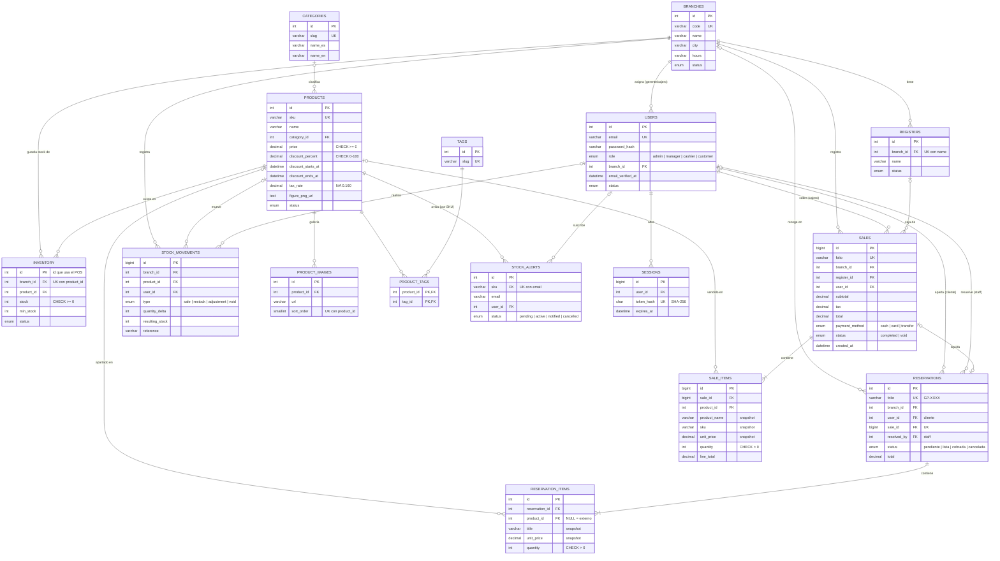

# Diagrama entidad-relación — GeekPoint

Modelo vigente desde la migración `2026_10_19_000001_normalizar_catalogo_inventario.sql`.
Fuente de verdad: [`database/schema.sql`](../database/schema.sql).

Tabla aislada (sin relaciones): `catalog_cache`, caché del catálogo externo (Jikan / AniList).

## Vistas

| Vista | Para qué |
|---|---|
| `v_inventory` | Una fila por producto × sucursal con la forma de la tabla anterior (`products` por sucursal). El PHP lee de aquí, así que la API responde igual que antes. |
| `v_consolidated_inventory` | Stock total por producto en toda la red, para el administrador general. |

## Qué cambió respecto al modelo anterior

| Antes | Ahora | Por qué |
|---|---|---|
| `products` con una fila **por sucursal** repitiendo nombre, precio, descripción e imágenes (85 productos en 224 filas) | `products` (catálogo, 1 fila por SKU) + `inventory` (stock por sucursal) | Tercera forma normal: un precio o un nombre se cambia en un solo lugar y no pueden quedar copias distintas |
| `image_url` con varias URLs separadas por coma | Tabla `product_images` ordenada | Primera forma normal: un valor por celda |
| `tags` como texto `"novedad,preventa"` | `tags` + `product_tags` (N:M) | Primera forma normal y etiquetas reutilizables |
| `reservation_items.product_ref` solo texto | Además `product_id` con llave foránea | Integridad referencial entre apartados y catálogo |
| `stock_alerts.sku` sin relación | FK a `products.sku` | Un aviso no puede apuntar a un SKU inexistente |
| Sin validaciones a nivel BD | `CHECK`: stock ≥ 0, precio ≥ 0, descuento 0–100, cantidades > 0, montos ≥ 0 | La base rechaza datos imposibles aunque el código falle |
| FK `fk_reservations_user` apuntando a `resolved_by` | Renombrada a `fk_reservations_resolved_by` | Nombre fiel a lo que relaciona |
| — | Índices en fechas de venta/apartado, caja, tipo de movimiento y expiración de sesión; únicos en caja por sucursal y venta por apartado | Reportes más rápidos y reglas de negocio garantizadas |
